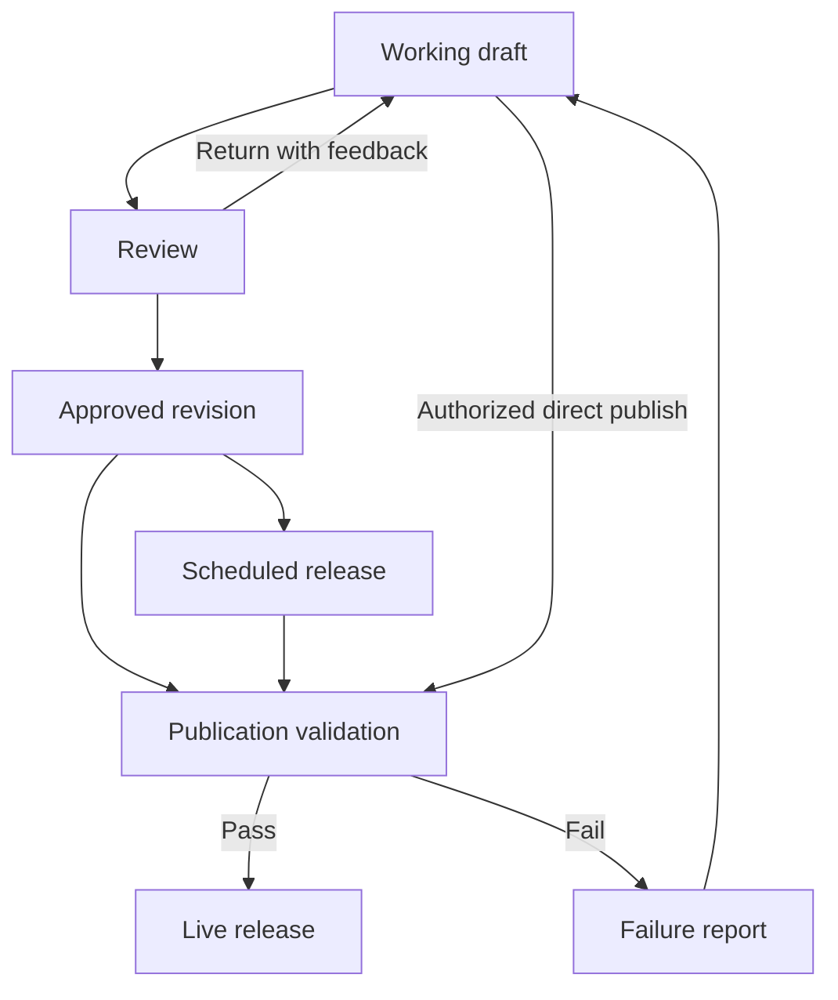

# Lagom — Admin Dashboard and CMS Requirements

Version: 1.0  
Status: Proposed implementation specification  
Documentation language: English  
Default storefront language: Vietnamese  
Default currency: VND  
Business timezone: Asia/Ho_Chi_Minh

## 1. Purpose and intended outcome

Lagom shall provide an administration application that allows authorized staff to manage the entire public flower storefront without editing source code. The CMS shall cover page content, page composition, shared templates, product information, prices, collections, images, navigation, business details, customer-facing messages, search metadata, and the storefront theme.

An Owner or Admin shall be able to open an existing public page, identify where each visible element is managed, change it, preview the result, and publish it. Changes shall persist in the backend and appear consistently to visitors after publication.

“Entire website editable” means every existing public-facing content field and supported presentation setting has an administration interface. New application capabilities, new section component types, and changes to transaction algorithms still require implementation work. The CMS must clearly distinguish editable content from calculated values and application behavior.

### 1.1 Context and assumptions

- Lagom is treated as the name of the flower storefront being built in this conversation. This document does not claim to audit an existing Lagom administration system.
- This specification extends the earlier Arch Flowers-inspired storefront requirements. The earlier exclusion of admin features is superseded by this new requirement.
- Keep suitable existing frontend and backend technology. This specification does not mandate a new framework or a particular commercial CMS.
- Use the implemented Lagom theme and approved assets as the initial baseline. Earlier reference documentation did not establish exact original theme values; do not invent an “extracted” palette or font.
- There are 60 previously cropped catalog images and a price extraction file, `flower_prices.json`. These are Lagom import inputs, not verified Arch Flowers product records.
- The initial CMS supports one business and one storefront. It does not require customer accounts, multiple shops, online payment processing, or an ERP.
- Admin screens may initially use English. Vietnamese content entry, search, typography, and formatting are mandatory. Locale fields shall permit a later English storefront without requiring it for launch.
- Numeric limits and service targets in this document are proposed product defaults, not observations about an existing system.

## 2. Release scope

### 2.1 Required for the complete CMS release

1. Staff authentication, permissions, and user management.
2. Dashboard, global search, and content issue reporting.
3. Page management and a section-based visual editor.
4. Shared page templates and reusable content sections.
5. Product, variant, price, availability, and collection management.
6. Media library and migration of existing images and content.
7. Navigation, header, footer, announcements, and contact links.
8. Theme editor with responsive preview and version history.
9. Business settings, delivery configuration, form copy, and system messages.
10. SEO fields, route registry, redirects, and sitemap integration.
11. Drafts, review, preview, immediate publication, scheduled publication, and coordinated releases.
12. Revision comparison, rollback, audit history, and recovery procedures.
13. Integration with the existing storefront so all supported content comes from published CMS data.

### 2.2 Conditional modules

| Module                | When included                                                     | Behavior when absent                                                    |
| --------------------- | ----------------------------------------------------------------- | ----------------------------------------------------------------------- |
| Orders                | The project already has or separately implements an order backend | Configure the current contact handoff; do not display fabricated orders |
| Inquiries             | A contact/custom bouquet form is enabled                          | Contact links continue to work without an inbox                         |
| Blog                  | The business enables editorial publishing                         | No empty public blog links or admin menu item                           |
| Inventory quantities  | An inventory source is connected                                  | Use manually controlled available/unavailable/preorder states           |
| Online payment        | A payment integration is explicitly included                      | Preserve the approved contact, COD, or bank-transfer flow               |
| Analytics             | Real event collection is configured                               | Show content metrics and “Not connected,” not invented sales or traffic |
| Discounts and coupons | A promotion calculation service is implemented                    | Support promotional content and explicit product sale prices only       |

Turning on a module shall require its backend capability and required configuration to be ready. A visible toggle alone must not create a nonfunctional public feature.

## 3. Main concepts

| Concept          | Meaning                                                                                  |
| ---------------- | ---------------------------------------------------------------------------------------- |
| Page             | A public route with metadata, a template, and page-specific content                      |
| Template         | A reusable layout for a page family, such as product detail or collection                |
| Section          | A configured instance of an implemented component, such as hero or product grid          |
| Shared section   | One reusable content record referenced by multiple pages                                 |
| Global content   | Site-wide header, footer, navigation, announcements, and business details                |
| Theme version    | A validated set of design tokens and supported component settings                        |
| Revision         | An immutable saved snapshot of one content entity                                        |
| Working draft    | The version currently being edited, separate from the live version                       |
| Release          | A specified set of revisions that becomes public together                                |
| Dynamic binding  | A section obtains values from products, collections, or settings rather than copied text |
| Protected region | A required functional part of a template, such as a product price or cart total          |

## 4. Roles and permissions

### 4.1 Default roles

| Capability                                     | Owner | Admin | Content Editor | Catalog Manager | Publisher        | Viewer |
| ---------------------------------------------- | ----- | ----- | -------------- | --------------- | ---------------- | ------ |
| Enter admin and view permitted content         | Yes   | Yes   | Yes            | Yes             | Yes              | Yes    |
| Edit pages and editorial content               | Yes   | Yes   | Draft          | No              | No               | No     |
| Edit products, variants, prices, collections   | Yes   | Yes   | No             | Draft           | No               | No     |
| Upload and manage media                        | Yes   | Yes   | Within scope   | Within scope    | Read             | Read   |
| Edit navigation, header, footer, UI copy       | Yes   | Yes   | Draft          | No              | No               | No     |
| Edit theme and shared layout templates         | Yes   | Yes   | No             | No              | No               | No     |
| Review and publish permitted revisions         | Yes   | Yes   | No             | No              | Yes              | No     |
| Schedule, cancel, or roll back releases        | Yes   | Yes   | No             | No              | Within scope     | No     |
| Change operational business settings           | Yes   | Yes   | No             | No              | No               | No     |
| Read audit records                             | All   | All   | Own activity   | Own activity    | Publishing scope | No     |
| Invite users and assign roles                  | Yes   | No    | No             | No              | No               | No     |
| Manage secrets and ownership                   | Yes   | No    | No             | No              | No               | No     |
| Export full content or initiate a full restore | Yes   | No    | No             | No              | No               | No     |

“Draft” includes create, edit, duplicate, request review, and preview within the assigned scope. It does not include making changes public. Admin has full control over site content and appearance; account ownership and infrastructure secrets are separate privileges.

### 4.2 Permission rules

- **PERM-01:** Permissions shall be evaluated by resource, action, scope, and restricted field group. A role name alone is insufficient when staff are assigned only certain pages or collections.
- **PERM-02:** Supported actions shall include read, create, edit, request review, approve, publish, schedule, archive, restore, export, and manage settings.
- **PERM-03:** Publishing permission shall cover every entity in a release, including shared dependencies. A Publisher assigned only editorial pages cannot publish a price or theme revision.
- **PERM-04:** Enforce all permissions on the server, including API requests, bulk operations, imports, previews, and asset downloads. Hiding a control is not enforcement.
- **PERM-05:** A Content Editor cannot override a product price by entering another number in a product card or by modifying a hidden JSON field.
- **PERM-06:** The Owner shall assign scopes and capability overrides to individual users using a readable permission form. A general-purpose custom-role designer is optional.
- **PERM-07:** At least one active Owner shall always remain. Ownership changes require reauthentication and audit logging.
- **PERM-08:** Removing a user or permission shall revoke affected access immediately, including preview access and outstanding sessions where applicable.
- **PERM-09:** Shared-resource edits shall display their full impact. Publishing shall require permission over all affected resources or escalation to an Admin/Owner.
- **PERM-10:** Customers shall never acquire staff permissions through storefront registration or public profile fields.

## 5. Administration navigation and screens

Use a persistent sidebar, breadcrumbs, a clear page title, and a primary action appropriate to the current screen. Keep storefront theme configuration separate from the styling of the administration interface.

| Area       | Main screens                                    | Key actions                                                |
| ---------- | ----------------------------------------------- | ---------------------------------------------------------- |
| Overview   | Dashboard and tasks                             | Resume edits, review issues, inspect scheduled work        |
| Website    | Pages, templates, reusable sections             | Create, edit, preview, duplicate, archive                  |
| Catalog    | Products, variants, collections, attributes     | Edit content, prices, ordering, availability               |
| Media      | Assets, folders, usages                         | Upload, search, replace by new version, inspect references |
| Appearance | Theme versions, header, footer, menus           | Configure, preview, compare, publish                       |
| Content    | FAQs, testimonials, policies, optional articles | Manage reusable structured content                         |
| Marketing  | Announcements and campaign landing pages        | Set content, targeting by page, visibility dates           |
| Publishing | Review queue, releases, calendar, history       | Approve, publish, schedule, cancel, roll back              |
| Business   | Store details, delivery, contact/order settings | Configure operational values and customer copy             |
| SEO        | Metadata issues, redirects, route registry      | Resolve missing fields and broken destinations             |
| Team       | Users, invitations, access scopes               | Owner-managed staff access                                 |
| Activity   | Audit history and job failures                  | Filter, inspect, retry permitted failed jobs               |
| Settings   | Locale, integrations, exports, recovery         | Manage technical settings by permission                    |

Conditional modules shall appear only when enabled and authorized. Global search shall search permitted pages, products, collections, and media; it shall not reveal restricted titles in suggestions.

### 5.1 Dashboard requirements

- **DASH-01:** Show real counts of published pages, unpublished changes, drafts awaiting review, scheduled releases, published products, and content issues.
- **DASH-02:** Show recent edits with actor and timestamp; link directly to the relevant editor or revision.
- **DASH-03:** Display failed publications, broken internal references, missing required media, and unresolved import rows as actionable tasks.
- **DASH-04:** Provide quick actions for creating a page, adding a product, uploading images, and editing the homepage, subject to permissions.
- **DASH-05:** An empty database shall show setup tasks. An empty review queue shall say there is nothing to review. A failed request shall show a retry state.
- **DASH-06:** Do not present sales, conversion rates, or traffic charts unless they are backed by configured data with a stated period and timezone.

## 6. Public page coverage

The route inventory shall include every existing public route, even if its editor is a shared template rather than an individual page record. Preserve existing routes unless an explicit migration creates redirects.

| Public surface                    | Editable content and presentation                                                         | Functional behavior that remains application-controlled |
| --------------------------------- | ----------------------------------------------------------------------------------------- | ------------------------------------------------------- |
| Homepage                          | Every section, headings, images, CTAs, product groups, story, spacing, ordering           | Data fetching and valid navigation                      |
| All products                      | Heading, intro, banner, filter labels, available filters, sort options, grid settings     | Product query correctness and pagination                |
| Collection                        | Name, slug, description, hero, membership, ordering, SEO, template overrides              | Published membership and server query rules             |
| Product detail                    | Name, gallery, description, variants, prices, labels, care notes, related items, metadata | Valid variant selection and price calculation           |
| Search results, if supported      | Placeholder, heading, suggestions, empty-state text, display settings                     | Search execution and permission-safe result selection   |
| Cart                              | Headings, labels, empty state, help text, recommendation section, theme                   | Line identity, quantity validation, totals              |
| Order/contact handoff             | Instructions, supported field labels, help, contact channels, consent text                | Validation, delivery eligibility, submission semantics  |
| Confirmation/status, if supported | Success/pending copy, instructions, contact CTA                                           | The actual backend order state                          |
| About/story                       | Full section composition, imagery, copy, links                                            | Valid routes                                            |
| Contact/custom bouquet            | Contact details, hours, map, approved form fields, instructions                           | Submission validation and delivery of messages          |
| Policies and FAQ                  | Titles, rich text, questions, answers, effective date, SEO                                | Published version selection                             |
| Campaign landing page             | Full section composition and page-specific theme options                                  | Existing commerce behavior                              |
| Blog index/article, if enabled    | Articles, categories, author display, cover, related content, SEO                         | Published filtering and routing                         |
| 404                               | Heading, explanatory copy, image, recovery CTAs                                           | Actual not-found response                               |
| Maintenance/error/offline states  | Supported messages, contact links, retry labels                                           | Real availability, retry, and error behavior            |
| Global header/mobile menu/footer  | Logo, links, menus, announcement, contacts, social links, layout options                  | Navigation accessibility and interaction                |
| Floating contact controls         | Channels, labels, icons, position preset, visibility                                      | Valid destination handling                              |

**COVER-01:** Implement a content ownership register: public route/pattern, visible element, CMS entity, field, template, and required permission.

**COVER-02:** No existing public heading, paragraph, button label, image reference, business detail, or explanatory message shall remain hardcoded without a documented reason and an approved editable source.

**COVER-03:** Dynamic content shall have an “Edit source” shortcut. A product card shall lead to its product record; a shared footer shall lead to global footer settings.

**COVER-04:** Editing text shall not change the meaning of system states. For example, an administrator may edit the pending-order message, but the application must not show a paid state for an unpaid order.

## 7. Page management

### 7.1 Page list

**PAGE-01:** Display title, route, page type, template, live status, unpublished-change indicator, working state, last editor, modification time, and next scheduled action. Support search, status/type filters, sorting, and pagination.

**PAGE-02:** Support create from template, duplicate as draft, edit, preview, open public page, compare versions, request review, publish, schedule, archive, and restore according to permission.

**PAGE-03:** Bulk actions shall report eligible and blocked records before execution and return per-record results. A mixed-permission selection shall never silently publish unauthorized records.

### 7.2 Page fields

| Field                | Requirement                                                                                  |
| -------------------- | -------------------------------------------------------------------------------------------- |
| Internal title       | Required; 1–120 characters; used in administration                                           |
| Public title         | Required when rendered; may differ from internal title                                       |
| Slug/path            | Unique after normalization; generated once and editable by permitted staff                   |
| Page type            | Home, standard, campaign, policy, or a registered template type                              |
| Template             | Required; compatible with the page type                                                      |
| Sections             | Ordered instances with stable identifiers                                                    |
| Locale               | Default `vi-VN`; retain locale association                                                   |
| SEO                  | Title, description, canonical policy, social image, indexability                             |
| Publish controls     | Review state, target release, schedule, optional end action                                  |
| Navigation placement | Optional explicit link creation; creating a page does not automatically add it to every menu |

**PAGE-04:** The homepage shall have one canonical assignment. Changing it shall be a release that preserves a valid `/` route.

**PAGE-05:** Reserve administration, API, static asset, and system-owned route patterns. Prevent conflicts between pages, products, collections, redirects, and normalized trailing-slash variants.

**PAGE-06:** Duplicating a page creates new page and section IDs, an unpublished state, and a unique proposed slug. It does not copy approval or scheduled publication.

**PAGE-07:** Archiving a live page shall require a valid redirect or deliberate not-found outcome, plus a report of affected navigation and internal links. Protected system pages require a valid replacement.

## 8. Visual page editor

### 8.1 Editor layout

Use three coordinated areas on desktop: section tree on the left, live preview in the center, and selected-item properties on the right. The top bar shall include page name, save state, live/draft status, viewport selection, preview, and the permitted review/publish action.

**EDIT-01:** Clicking an element in preview selects its editable section or field. Selection shall not accidentally navigate away or submit a public form.

**EDIT-02:** Provide a list/form editing mode for keyboard users and narrow screens. Dragging shall have Move up/Move down alternatives.

**EDIT-03:** Support add, duplicate, reorder, hide, show, and remove sections. Removal shall be undoable before save and recoverable through history afterward.

**EDIT-04:** Autosave shall run approximately two seconds after editing stops. Show “Saving,” “Saved at…,” “Unsaved changes,” or a specific failure. Saving never publishes.

**EDIT-05:** Preserve the draft when validation fails. Highlight invalid fields and explain how to resolve them. Required publication checks may remain incomplete while saving a draft.

**EDIT-06:** Warn before navigation with unsaved changes. On network loss, keep the current editing buffer and allow retry; never show a false saved state.

**EDIT-07:** Use revision checks to prevent lost updates. If another editor saves first, offer a comparison and explicit reconciliation rather than last-write-wins.

**EDIT-08:** Preview desktop, tablet, and mobile with the same public rendering components and CSS. Test sizes are preview aids, not evidence of existing breakpoints.

**EDIT-09:** Show source and inheritance: Global → Template → Page → Section. Resetting a permitted override restores inheritance instead of writing another copied value.

### 8.2 Section library

| Section type                | Editable fields                                                                    | Important rules                                              |
| --------------------------- | ---------------------------------------------------------------------------------- | ------------------------------------------------------------ |
| Hero/banner                 | Eyebrow, heading, body, desktop/mobile image, focal point, CTA, alignment, overlay | At least one valid content element; CTA requires destination |
| Slideshow                   | Ordered hero slides, controls, optional autoplay, interval                         | Keyboard controls, pause, reduced-motion behavior            |
| Rich text                   | Structured headings, paragraphs, lists, links, emphasis                            | Sanitized content; no arbitrary script or executable HTML    |
| Image and text              | Image, alt text, title, body, CTA, media position                                  | Separate mobile arrangement option                           |
| Product grid/carousel       | Product/collection source, count, title, columns, sort, CTA                        | Price and availability always bind to catalog data           |
| Collection grid             | Collection references, cards, title, ordering                                      | Only published valid destinations appear                     |
| Gallery                     | Ordered assets, captions, crop, columns, optional lightbox                         | Alt text and responsive image generation                     |
| Brand story                 | Headline, story blocks, supporting images, CTA                                     | May reference reusable business content                      |
| Benefits/service highlights | Icon preset, title, explanation, destination                                       | Bounded item count and consistent token-based styling        |
| Testimonials                | Approved quote, display name, optional image, source/date                          | Never fabricate testimonials; only approved records publish  |
| FAQ                         | Question/answer references or page-local entries                                   | Accessible expand/collapse; stable item IDs                  |
| Contact details             | Business reference, selected channels, hours, CTA                                  | Default to the canonical business record                     |
| Map                         | Approved map location/embed configuration, fallback address/link                   | Provider configuration only; no unrestricted iframe markup   |
| Contact/custom bouquet form | Supported fields, labels, help, destination configuration                          | Requires a working form service before publication           |
| Announcement/promotion      | Message, CTA, variant, optional visibility window                                  | Content alone cannot create a price discount                 |
| Related products            | Manual selection or approved recommendation rule                                   | Exclude current product and unavailable references           |
| Policy/article body         | Structured content, effective date, optional contents list                         | Revision history and semantic headings                       |
| Divider/spacer              | Preset size, line visibility, color token                                          | Bounded values; no unbounded layout manipulation             |

### 8.3 Section and template rules

- **BLOCK-01:** Each section shall have an ID, type, schema version, content, design settings, bindings, and visibility settings.
- **BLOCK-02:** Use registered schemas and validated options. Unsupported component types cannot be injected through JSON import.
- **BLOCK-03:** Support visibility by page and device class. Essential purchase actions and required notices cannot be hidden at all supported widths.
- **BLOCK-04:** Product and collection templates shall expose editable regions while preserving required functional components. Staff may rearrange supported slots; they may not remove the only price or purchase control.
- **BLOCK-05:** Distinguish “Duplicate as independent section” from “Reuse shared section.” The editor shall state whether a change affects one page or multiple pages.
- **BLOCK-06:** Before publishing a shared section/template, show impacted routes and representative previews. Existing page overrides remain explicit.
- **BLOCK-07:** Manual product selections shall show unavailable/unpublished references in the editor. Published output shall omit ineligible cards and follow a configured empty-section fallback.
- **BLOCK-08:** Automatic grids query the published catalog by configured rules. They do not copy prices or descriptions into the page record.
- **BLOCK-09:** Switching templates shall preview mapped and unmapped content. Preserve unmapped data in the prior revision and require review before publishing.
- **BLOCK-10:** Public page rendering shall reject unknown or invalid block data with an observable fallback; it shall not crash the entire storefront.

## 9. Product catalog and pricing

### 9.1 Product editor

| Group          | Fields and controls                                                                   |
| -------------- | ------------------------------------------------------------------------------------- |
| Identity       | Immutable internal ID, unique SKU, optional printed catalog number, name, slug        |
| Content        | Short description, structured full description, care instructions, substitution notes |
| Classification | Collections, occasion, flower types, color tags, approved attributes                  |
| Media          | Cover, gallery, order, per-image alt text, focal point, mobile crop                   |
| Variants       | Variant ID/SKU, name, option values, image, price, availability                       |
| Price          | Integer VND amount, optional compare-at price, optional explicit sale price and dates |
| Availability   | Available, unavailable, or preorder; optional fulfillment lead time                   |
| Merchandising  | Badges, featured status, related products, display priority                           |
| Delivery       | Supported delivery restrictions, preparation time, additional approved instructions   |
| SEO            | Search title/description, slug, social image, indexing control                        |
| Lifecycle      | Working revision, review state, publication, archive, history                         |

- **CAT-01:** Products with no visible options shall still have one default variant so pricing and order logic use one consistent model.
- **CAT-02:** Variant combinations and SKUs shall be unique. Deleting a referenced variant shall archive it and preserve historical order references where orders exist.
- **CAT-03:** Store all VND prices as integers. Reject negative values, non-integer amounts, and invalid localized numeric input. A zero price shall require an explicit free-item mode; “Contact for price” is a separate state.
- **CAT-04:** A compare-at price shall exceed the effective sale price. A sale period shall have a valid start/end range in the business timezone. Calculate the effective price from published data and current server time.
- **CAT-05:** A product with differently priced variants shall show the configured “from” representation on cards and the selected variant's exact price on its detail page.
- **CAT-06:** Price changes shall display old/new values and affected variants before publication. Bulk changes shall support preview, explicit selection, and per-row validation.
- **CAT-07:** The public product page, cards, cart, and order service shall resolve the same effective price. Revalidate at order submission and tell the customer when a previously displayed price has changed.
- **CAT-08:** Catalog editing shall not rewrite accepted order snapshots. Inventory or fulfillment state, when implemented, shall remain separate from editorial rollback.
- **CAT-09:** Unavailable products may remain visible with approved copy but shall not expose an active purchase action unless the configured mode permits preorder or inquiry.
- **CAT-10:** Product archive/publication changes shall update search, collection results, related items, sitemap eligibility, and cached detail routes.

Price precedence is explicit: use the published sale price while its optional time window is active; otherwise use the published regular price. A compare-at amount is display information and never the payable amount. The start instant is inclusive and the end instant is exclusive. Both dates omitted means an ongoing sale; a supplied date must be valid, and an end must follow a start when both exist. Cache refresh at sale boundaries shall keep displayed prices current, while submission always revalidates the server-calculated amount. Coupon stacking and arbitrary pricing formulas are outside this baseline.

### 9.2 Import the existing 60-item image and price set

**IMPORT-01:** Provide a dedicated importer for `flower_prices.json` and the corresponding image files. Import to drafts and present a review screen before committing.

| Existing input field | Destination               | Import rule                                                      |
| -------------------- | ------------------------- | ---------------------------------------------------------------- |
| `id`                 | External import key       | Preserve as a stable identifier; combine with a source namespace |
| `product_number`     | Printed catalog number    | Display-only reference; not a unique SKU                         |
| `price_vnd`          | Default variant price     | Validate as an integer and confirm VND                           |
| `price_label`        | Source/provenance field   | Preserve original label; do not use it as a numeric price        |
| `source_image`       | Source asset reference    | Retain for traceability                                          |
| `position`           | Source position           | Retain for resolving repeated printed numbers                    |
| `cropped_image`      | Gallery/cover asset match | Match by exact filename; show missing and duplicate matches      |

- **IMPORT-02:** Keep all 60 entries. Printed numbers 39, 40, and 41 occur on different source images and shall remain separate products unless an administrator explicitly merges them.
- **IMPORT-03:** Reimporting the same namespace and external key shall propose updates instead of creating duplicates. Show new, unchanged, modified, and invalid rows separately.
- **IMPORT-04:** The images do not provide verified product names, flower composition, or descriptions. Use visibly provisional draft names such as “Bouquet 39 — page 04” and require owner review before publication.
- **IMPORT-05:** Embedded price text in a photograph does not update when a catalog price changes. Mark such assets as containing printed prices; warn on mismatch, and allow replacing the image or displaying an approved current-price notice. Never silently alter the photograph or claim its embedded price was updated.
- **IMPORT-06:** Preserve the original uploads. Image cleanup or cropping creates separate derivatives and retains the source relationship.
- **IMPORT-07:** Import shall have a dry run, schema validation, job progress, row errors, and a downloadable result report. Retry shall not duplicate successful rows.
- **IMPORT-08:** General CSV/JSON catalog import shall require explicit field mapping and conflict choices. Imported values cannot grant permissions, publish automatically, or introduce executable content.

## 10. Collections, taxonomy, and merchandising

- **COL-01:** Edit collection title, slug, short/full description, cover, banner, SEO, template, and navigation visibility.
- **COL-02:** Support manual membership with ordering and rule-based membership using approved fields such as occasion, flower type, color, price, and availability.
- **COL-03:** Show a preview count and sample results before publishing a rule. Define whether multiple conditions use ALL or ANY; do not leave this implicit.
- **COL-04:** Manual featured positions shall have a documented relationship to the default sort. Customer-selected sorting shall override merchandising order unless explicitly labeled otherwise.
- **COL-05:** Configure visible filters, labels, value ordering, default sort, allowed sort options, and page size within implemented limits.
- **COL-06:** Rename or merge taxonomy values with an impact preview. Changes shall preserve product associations and update filters consistently.
- **COL-07:** Define empty collection behavior: show approved empty-state content, recommend alternatives, or omit a homepage collection section. Do not redirect silently.
- **COL-08:** Promotional badges may bind to actual sale state or use approved editorial labels. A banner saying “20% off” shall require an associated pricing configuration or an explicit review warning; the text itself does not change totals.

## 11. Media library

- **MEDIA-01:** Support upload, folders/tags, search, filtering by type and usage, and a selectable asset grid. The same asset may be used in multiple places.
- **MEDIA-02:** Initial raster support shall include JPEG, PNG, WebP, and AVIF where the processing pipeline supports them. Default maximum upload size is 20 MB per image, adjustable by the Owner. Validate actual content, dimensions, and type on the server.
- **MEDIA-03:** Preserve originals; create responsive derivatives. Cropping and focal-point changes shall be nondestructive. Prevent decompression and dimension abuse through configured server limits.
- **MEDIA-04:** Store filename, display title, dimensions, size, type, alt text, caption, focal point, attribution/usage notes, source, and creator/time.
- **MEDIA-05:** Informative images require alt text. Decorative images require an explicit decorative designation rather than meaningless generated alt text.
- **MEDIA-06:** Allow per-placement alt text and crop overrides when the same image serves a different purpose. Show whether each field is inherited from the asset.
- **MEDIA-07:** Show all usages before replacement or deletion. Replacing an asset creates a new immutable version; publishing affected references is explicit. Historical revisions retain the old asset version.

For restricted staff, show authorized usages plus a count of restricted dependencies without exposing their titles or content. If an action affects those dependencies, require an appropriately scoped Admin/Owner to complete it.

- **MEDIA-08:** Block deletion of assets referenced by live content or retained revisions. Unreferenced assets may be archived and later purged according to retention rules.
- **MEDIA-09:** SVGs, fonts, documents, and video require separate approved processing rules. Do not treat arbitrary uploaded SVG or HTML as safe inline content.
- **MEDIA-10:** Draft-only assets shall not be discoverable through public listings or guessed media IDs. Preview access shall use authorized delivery. Previously public media may remain cached externally after withdrawal; the UI shall not promise universal removal.
- **MEDIA-11:** Upload progress, failure, retry, missing image, and processing states shall be visible. A media processing failure shall not create a broken published reference.

## 12. Theme and appearance editor

Theme control is a first-class CMS module. Staff shall be able to evolve the storefront's appearance without scattering inline styles across pages.

### 12.1 Editable theme settings

| Group                | Supported settings                                                                                   |
| -------------------- | ---------------------------------------------------------------------------------------------------- |
| Brand assets         | Primary/alternate logo, favicon, social sharing default                                              |
| Colors               | Page/surface backgrounds, text, muted text, brand, links, borders, sale, focus, success/error        |
| Typography           | Approved font families/files, weights, heading/body/price styles, sizes, line height, letter spacing |
| Layout               | Container width, page gutter, section spacing, grid gaps, supported column counts                    |
| Shapes               | Button, input, card, image, and panel radii; border presets                                          |
| Elevation            | Approved shadow presets for cards, header, menus, dialogs                                            |
| Buttons and controls | Size presets, fill/outline variants, hover/focus/disabled states                                     |
| Product cards        | Image ratio, crop behavior, visible fields, badge placement, supported hover behavior                |
| Header               | Logo size, menu layout preset, sticky option, supported mobile behavior                              |
| Footer               | Column layout, alignment, background variant, legal/contact group arrangement                        |
| Motion               | Approved transitions, duration bounds, reduced-motion alternative                                    |
| Responsive settings  | Overrides at implemented breakpoints; preview at intermediate widths                                 |

### 12.2 Theme rules

- **THEME-01:** Seed the baseline from approved existing Lagom tokens and component settings. Preserve that baseline as an immutable restorable version.
- **THEME-02:** Every setting shall have a readable label, unit, valid range or enum, default/inherited value, and representative preview.
- **THEME-03:** Theme changes remain draft until publication. Preview the entire site using the chosen theme revision, including catalog, cart, forms, and error states.
- **THEME-04:** Allow only validated color formats, numeric values, approved font assets, and registered presets. Do not expose arbitrary JavaScript, raw CSS injection, or unrestricted external font URLs in routine administration.
- **THEME-05:** Show contrast and readability issues before publication. Required controls and labels must remain usable; provide actionable validation rather than a generic failure.
- **THEME-06:** Fonts must render Vietnamese diacritics, numerals, and currency correctly. A missing font shall have a defined fallback, and a failed font upload shall block its publication.
- **THEME-07:** Global tokens shall propagate across all corresponding components. Page-level variations may override only explicitly supported tokens and remain visible as overrides.
- **THEME-08:** Breakpoint structure shall follow the implemented responsive system. Staff can adjust supported per-breakpoint settings; arbitrary breakpoint creation is an advanced engineering change.
- **THEME-09:** Provide theme comparison, draft duplication, reset-to-inherited controls, and restoration of a previous theme revision.
- **THEME-10:** A site-wide theme release shall include an impact summary and preview checklist for home, collection, product, cart, policies, and mobile navigation.
- **THEME-11:** Storefront theme changes must not make the administration application unreadable. Admin uses a stable interface with limited branding.

## 13. Navigation and global content

- **GLOBAL-01:** Edit header, footer, announcement bar, floating contact controls, and business details through dedicated screens that identify their site-wide effect.
- **GLOBAL-02:** Menu items shall support internal entity references, approved external URLs, telephone links, and supported contact channels. Internal links use stable entity IDs so slug changes do not leave stale copied URLs.
- **GLOBAL-03:** Support ordered menus, up to three supported navigation levels, mobile labels, optional icons, and visibility. Prevent cycles and invalid parent relationships.
- **GLOBAL-04:** An internal menu target must already be published or be included in the same release. Publishing a menu with a draft-only target is blocked.
- **GLOBAL-05:** Maintain canonical business fields for brand name, address, contact numbers, email, social links, opening hours, and location. Allow explicit per-placement wording, not accidental duplicate business records.
- **GLOBAL-06:** Announcement bars support text, CTA, enabled state, page targeting, dismissibility, and start/end times. A changed announcement version resets dismissal only according to an explicit policy.
- **GLOBAL-07:** Cookie/privacy notices, if present, shall expose editable explanatory content and links. Editing their wording does not implement a consent mechanism by itself.
- **GLOBAL-08:** Required footer policy links and contact access shall be validated before publishing a global layout.

## 14. Business configuration, forms, and interface copy

### 14.1 Business and delivery settings

- **BIZ-01:** Configure business timezone, default currency, opening hours, closed dates, service areas, contact channels, and current ordering mode.
- **BIZ-02:** Manage delivery slots, lead times, cutoffs, date-specific overrides, and optional capacity when supported. The public interface and backend validation shall consume the same rules.
- **BIZ-03:** Validate that schedules do not overlap incompatibly, end before they start, or reference missing service areas. Preview eligibility for sample dates before publication.
- **BIZ-04:** Delivery and shipping settings shall support known fixed/rule-based quotes or an explicit awaiting-confirmation state. Unknown shipping must never become zero by default.
- **BIZ-05:** Configure approved bank-transfer instructions only when that payment mode exists. Changing financial destination details requires reauthentication and audit logging.
- **BIZ-06:** Disabling ordering shall show configured customer-facing guidance. It shall not delete carts or existing orders. Re-enabling requires valid operational configuration.

### 14.2 Forms and microcopy

- **COPY-01:** Provide a searchable catalog of all customer-facing interface strings: buttons, field labels, placeholders, helper text, validation messages, loading states, empty states, errors, status explanations, and accessibility labels.
- **COPY-02:** Group strings by public surface and provide a preview/use-location link. System keys remain stable when the displayed text changes.
- **COPY-03:** Preserve typed placeholders such as `{productName}`, `{amount}`, and `{deliveryDate}`. Reject missing, additional, or invalid placeholders and render values safely.
- **COPY-04:** Display translations independently of application logic. Never infer payment/order state from a translated string.
- **COPY-05:** Form configuration supports registered field types, labels, help text, optional fields, choices, and validation messages. Required transactional fields may be renamed but cannot be removed without a compatible workflow.
- **COPY-06:** Published forms require a working destination and defined success/failure behavior. Preview submissions shall be disabled or use an isolated test destination; they shall not contact real customers or create real orders.
- **COPY-07:** Missing localized content shall use an explicit fallback policy and be flagged in admin. A later second-language launch shall not silently publish mixed-language pages as complete translations.
- **COPY-08:** Treat customer inquiries and order details as private operational data. Do not include them in public content exports, asset metadata, or public search.

## 15. Search metadata, routes, and discoverability

- **SEO-01:** Allow page/product/collection title, description, social image, indexability, and permitted canonical override. Provide previews and length guidance; valid longer copy is a warning rather than automatic truncation.
- **SEO-02:** Generate canonical URLs from the configured Lagom deployment domain. Do not retain the reference site's domain or product identifiers accidentally.
- **SEO-03:** Derive structured product data from the same published price and availability used by the storefront. Do not invent ratings or review counts.
- **SEO-04:** Maintain one route registry across CMS pages, products, collections, reserved routes, and redirects. Normalize case/slashes according to the established application policy.
- **SEO-05:** Changing a published slug shall offer an old-to-new permanent redirect and update internal entity links. Prevent loops, chains where avoidable, and destinations that conflict with live routes.
- **SEO-06:** A deliberate temporary redirect shall be distinguishable from a permanent redirect. External redirects require an allowed destination and an explicit action.
- **SEO-07:** Sitemap entries shall include only eligible published canonical routes. Drafts, previews, admin routes, and aliases shall not be listed.
- **SEO-08:** Public errors shall retain correct response behavior; an editable 404 page must still return a not-found response.
- **SEO-09:** Search and metadata generation shall read published data only. Preview pages shall require authorization and be marked non-indexable.
- **SEO-10:** An issue screen shall report missing required metadata, conflicting canonicals, broken internal targets, and orphaned routes without claiming to guarantee search rankings.

## 16. Drafts, approval, and publication

### 16.1 Separate live state from editing state

A page may be live while a newer revision is a draft or awaiting review. Do not represent these as one mutually exclusive status field.

| State dimension   | Values                                                    | Meaning                                       |
| ----------------- | --------------------------------------------------------- | --------------------------------------------- |
| Entity visibility | Unpublished, published, archived                          | Whether a live revision is publicly available |
| Working revision  | Draft, in review, approved                                | Editorial readiness of a particular revision  |
| Release job       | Draft, scheduled, publishing, published, failed, canceled | Execution state of a defined publication      |

A returned review becomes a draft with feedback. Any edit to an approved revision creates a new revision requiring validation and, where enabled, approval again. Published revisions are immutable.

### 16.2 Publication rules

- **PUB-01:** Save, preview, approve, schedule, and publish shall be distinct actions. Routine edits must never change live content immediately.
- **PUB-02:** Owner/Admin may publish validated drafts directly by default. Editors submit for review; Publishers may approve and publish only within their granted scopes.
- **PUB-03:** The Owner may enable mandatory independent review by resource type. Under that policy, the last editor cannot approve the same revision. Any permitted Owner override requires a reason and audit record.
- **PUB-04:** A review request shall identify the exact revision. The reviewer sees field/content differences, media changes, affected pages, and validation issues.
- **PUB-05:** An approval becomes stale if its content or approved dependencies change. The UI shall distinguish the approved revision from newer edits.
- **PUB-06:** Before publishing, validate permissions, revision versions, required fields, routes, assets, product bindings, template compatibility, theme validity, and dependency availability.
- **PUB-07:** The publication dialog shall list included entities, changed fields, impacted routes, known warnings, and effective time. It shall not silently add unrelated draft revisions.
- **PUB-08:** A release may include a page, its new collection, new products, navigation links, shared content, and theme changes so a campaign goes live coherently.
- **PUB-09:** Publish each release atomically through an immutable release manifest and a single active-release pointer, or an equivalent consistent mechanism. Readers shall not observe half of a coordinated release.
- **PUB-10:** Build/validate the candidate before activating it. A failed job leaves the previous release live and provides a retryable error with preserved inputs.
- **PUB-11:** Publication requests and background jobs shall be idempotent. Double-clicks, network retries, or worker restarts shall not publish twice or create duplicate history entries.
- **PUB-12:** Public responses and cache keys shall identify the release version. A visitor may briefly receive a complete older release while caches refresh, but never a mixture of incompatible content from one response.
- **PUB-13:** Normal successful publication shall reach public routes within 60 seconds under the agreed production test conditions. The admin shall distinguish “Activated” from “Cache refresh pending/failed.”
- **PUB-14:** Content publishing shall not require a developer to edit source files or manually deploy the frontend. Introducing a new section component or schema may require a normal application deployment.

### 16.3 Scheduling and expiry

- **SCHED-01:** The scheduler shall run on the backend and survive closing the browser. Display local business time and timezone; store publication instants consistently.
- **SCHED-02:** Scheduling pins exact revisions and the expected live revisions they replace. Later edits shall not silently modify a scheduled release.
- **SCHED-03:** At execution, recheck the scheduling user's active publishing permission, approvals, required dependencies, and content conflicts. A revoked account or invalid dependency blocks the release and alerts authorized staff.
- **SCHED-04:** When the active site changed since scheduling, merge only unrelated approved updates into the new manifest. If any targeted revision changed, fail with a conflict for review; never restore an outdated whole-site snapshot accidentally.
- **SCHED-05:** Permit authorized cancellation and explicit replacement of a scheduled release. Show the exact revisions and dates in the publishing calendar.
- **SCHED-06:** An expiry action shall specify hide, archive, replace, or restore an explicitly chosen revision. Never assume that an earlier homepage should automatically replace a newer manual edit.
- **SCHED-07:** Detect overlapping campaigns, announcement schedules, and sale windows affecting the same target. Require resolution or a defined precedence before scheduling.
- **SCHED-08:** Record execution attempts and failures. A worker retry shall revalidate current conditions and use the same idempotency identity.

## 17. Preview and revision history

- **PREVIEW-01:** Staff can preview a single entity against the current live site or preview a complete proposed release. The preview header shall identify which mode and revision are shown.
- **PREVIEW-02:** Preview shall use the same renderer, routing, token system, and data contracts as production, with a different authorized content resolver.
- **PREVIEW-03:** Draft access requires staff authentication and scope checks. Optional external preview links shall be scoped, expiring, revocable, and auditable; default expiry is 24 hours.
- **PREVIEW-04:** Preview responses shall not enter public caches or search indexes. An unguessable URL alone is insufficient authorization for private content.
- **PREVIEW-05:** Interactive controls in preview shall not place real orders, submit real inquiries, charge payments, or emit production conversion events.
- **HIST-01:** Record named revisions and publication snapshots with actor, timestamp, change summary, and parent revision. Debounced autosaves may be compacted, but submitted and published revisions are retained.
- **HIST-02:** Compare text, rich-text structure, prices, section order, settings, and asset thumbnails. Make numeric and global changes conspicuous.
- **HIST-03:** Restoring a prior revision creates a new draft; it does not erase history. Publishing that restoration follows ordinary validation and authorization.
- **HIST-04:** Provide a one-action entry point for whole-release rollback followed by an impact review. Targeted rollback changes selected content only; whole-release rollback explicitly includes all content and prices in its scope.
- **HIST-05:** Rollback never reverses payments, accepted orders, inquiries, inventory movements, or external messages. Those operational systems have separate corrective workflows.

## 18. Audit, export, and recovery

- **AUDIT-01:** Log staff access changes, content mutations, approval decisions, publication attempts, schedules, cancellations, imports, exports, restores, and sensitive settings changes.
- **AUDIT-02:** Capture actor, action, resource, revision/release, timestamp, outcome, and relevant before/after fields. Redact secrets and unnecessary customer data.
- **AUDIT-03:** Application users cannot edit or delete audit entries. Provide filters for actor, action, resource, time, and failure state.
- **AUDIT-04:** Keep audit records for at least 180 days by default. Retain published revisions until an Owner-approved retention policy and reference checks permit removal.
- **BACKUP-01:** Back up content, media references/originals, theme, permissions, and release manifests. A database-only backup without referenced assets is incomplete.
- **BACKUP-02:** Initial operational targets are a maximum 24-hour backup gap and a restore exercise completing within four hours on the agreed environment. These targets require deployment support and verification.
- **BACKUP-03:** Keep at least 30 daily backup points by default and document how to test restoration in an isolated environment.
- **BACKUP-04:** Content export shall include schemas, IDs, revisions, assets/manifests, navigation, theme, and relationships. Exclude secrets and private orders/inquiries by default.
- **BACKUP-05:** Importing an export shall support validation and an impact preview. It shall not overwrite user permissions, integration credentials, or live content automatically.
- **BACKUP-06:** Destructive actions shall use archive/trash first where feasible. Purging retained data requires explicit impact review and shall never bypass live/historical reference protection.

## 19. Logical data model

The implementation may map these concepts to relational tables or another suitable persistent store. Stable IDs, immutable revisions, server validation, and referential integrity are required regardless of technology.

| Entity                   | Essential fields/relationships                                                             |
| ------------------------ | ------------------------------------------------------------------------------------------ |
| StaffUser                | ID, identity, status, role assignment, scope grants, authentication references             |
| PermissionGrant          | Principal, resource type/ID, action, field group, scope                                    |
| Page                     | ID, type, locale, working revision, route relationship, visibility                         |
| ContentRevision          | Entity ID/type, immutable payload, schema version, parent, actor, time, content hash       |
| PageTemplate             | ID, schema version, editable regions, protected regions, allowed sections, revision        |
| SectionInstance          | ID, type, content, settings, bindings, visibility, schema version                          |
| SharedSection            | ID, revision payload, referenced asset/entity IDs                                          |
| Product                  | ID, external import key, printed number, slug relationship, revision                       |
| ProductVariant           | Stable ID, SKU, option tuple, price fields, availability configuration                     |
| Collection               | ID, membership mode/rules, manual ordering, template, revision                             |
| TaxonomyTerm             | ID, type, label, slug/key, active status                                                   |
| MediaAsset/MediaVersion  | Stable asset ID, immutable file version, derivatives, metadata, processing status          |
| MediaUsage               | Asset version, entity/revision, field/placement, contextual alt/crop                       |
| ThemeRevision            | Validated tokens, component settings, compatible renderer/schema version                   |
| Navigation/GlobalContent | Stable IDs, locale, structured content, references, revision                               |
| SiteSettings             | Public business configuration and revision; separate protected secret references           |
| UIString                 | Stable key, locale, template text, typed placeholders, revision                            |
| Route/Redirect           | Normalized path, locale, entity target or redirect, response behavior                      |
| Review                   | Revision, requester, reviewer, decision, feedback, timestamps                              |
| Release/ReleaseItem      | Release ID, exact entity/revision targets, expected base versions, manifest, actor, status |
| Schedule                 | Release/action, due time, timezone display, retries, cancellation, last result             |
| AuditEvent               | Append-only action metadata, entity/revision, actor, outcome, redacted changes             |
| ImportJob                | Source namespace, file hash, row mapping, proposed mutations, errors, completion state     |

### 19.1 Data integrity requirements

- **DATA-01:** Slugs, names, image filenames, and printed catalog numbers shall not serve as immutable primary keys.
- **DATA-02:** Published content reads shall resolve revisions from the active release manifest, including theme, navigation, products, prices, and reusable content. A new independent product publication creates a new manifest based on the current live state.
- **DATA-03:** Operational quantities, orders, and inquiry states shall use their own stores and current server validation. They are not rolled back by changing a content manifest.
- **DATA-04:** Validate referential integrity before a release is activated. Dynamic collections may change their result set as published products change; their membership rules remain versioned.
- **DATA-05:** A page draft referencing a product ID sees its current published revision unless the preview/release explicitly includes another revision. Show that distinction in preview.
- **DATA-06:** Content/schema migrations shall preserve existing published revisions or provide a compatible renderer. Historical rollback must not select data the current application cannot render.
- **DATA-07:** Use optimistic concurrency for draft writes and compare-and-swap or equivalent transactional control for release activation.
- **DATA-08:** Store customer-independent editorial data separately from private operational records and secrets.

## 20. Backend and storefront integration contracts

These are semantic contracts; route names are illustrative and shall follow the existing project's conventions.

| Contract                 | Typical interface                            | Required behavior                                             |
| ------------------------ | -------------------------------------------- | ------------------------------------------------------------- |
| Read content list/detail | `GET /admin/pages`, `/admin/products`        | Permission filters, pagination, revision metadata             |
| Save working revision    | `PATCH /admin/{entity}/{id}`                 | Schema validation, expected version, new revision, audit      |
| Manage assets            | `POST /admin/media`, asset detail endpoints  | Authenticated processing, immutable versions, usage checks    |
| Request/decide review    | `POST /admin/reviews` and decision action    | Exact revision, permissions, independent-review rule          |
| Build/validate release   | `POST /admin/releases` and validation action | Exact changes, dependencies, impact report, no live mutation  |
| Publish/schedule         | Release action endpoints                     | Idempotency key, authorization, transactional activation      |
| Preview                  | Authenticated preview resolver               | Explicit revision scope, no public cache, no real submissions |
| Read public content      | Public page/catalog resolver                 | Published manifest only; no private fields or draft leakage   |
| Resolve current price    | Domain pricing service                       | Effective published price and current operational eligibility |
| Import                   | Import upload, dry-run, apply, status        | Stable external keys, per-row validation, idempotent apply    |
| Inspect history/audit    | Read-only authorized endpoints               | Filtered scope, immutable records, secret redaction           |

- **API-01:** Return structured field errors with a human-readable summary. Distinguish unauthenticated, unauthorized, not found, validation failure, revision conflict, and service failure.
- **API-02:** Authorize the requested resource and every referenced restricted field; do not allow mass assignment of ownership, role, publication, or protected system fields.
- **API-03:** Public serialization shall explicitly allowlist fields. Do not return internal cost information, staff identities, draft payloads, private inquiry data, or secret configuration.
- **API-04:** Background work shall report progress and final status. Failed media/import/publication jobs shall retain enough context for safe retry.
- **API-05:** Theme tokens, content records, and catalog data shall have versioned contracts shared with the public renderer. Avoid separately maintained hardcoded copies.
- **API-06:** Integrate with existing catalog, content, cart, delivery, and order service boundaries. Replacing the existing repository stack is not an acceptance requirement.

## 21. Security, reliability, accessibility, and UX quality

### 21.1 Staff access and content safety

- **SEC-01:** Provide individual staff accounts, secure authentication, invitation expiry, password/identity recovery, session revocation, and rate limits. No shared default production account.
- **SEC-02:** Require multifactor authentication for Owner and Admin accounts in production. Protect active sessions and apply appropriate request-forgery controls for the chosen authentication architecture.
- **SEC-03:** Reauthenticate before ownership changes, credential changes, full restore, and changes to bank-transfer destination details.
- **SEC-04:** Sanitize rich text, validate link schemes, validate uploads, and block executable content in normal content fields. Any server-side remote fetch shall restrict destinations and reject internal-network targets.
- **SEC-05:** Keep integration secrets in a protected server-managed store. Show masked status and replace/test controls rather than returning existing secret values to the browser.
- **SEC-06:** Preview tokens, authentication secrets, private form data, and sensitive headers shall not appear in application logs or analytics payloads.

### 21.2 Administration usability

- **UX-01:** Every mutation shows a clear scope: this page, this template, these products, or the entire website.
- **UX-02:** Persistent save/review controls shall remain reachable on long editors. Destructive actions must not sit beside routine save controls without differentiation.
- **UX-03:** Tables shall support keyboard navigation, selection, filters, pagination, and useful empty states. Preserve filters when returning from an editor.
- **UX-04:** All controls shall have labels, visible focus, usable contrast, and keyboard operation. Reordering shall not require dragging; modal focus shall be managed correctly.
- **UX-05:** Distinguish loading, empty, permission denied, validation error, conflict, offline, and server error states. Do not replace user content with a generic blank screen.
- **UX-06:** Vietnamese search, diacritics, currency entry/display, and long text shall work without clipping or corrupted characters.
- **UX-07:** Administration editing shall be fully usable at 1280 px desktop width and on tablet. Phone layouts must support essential review and emergency content actions through form/list mode.
- **UX-08:** Show content and issue counts from real queries. Avoid ornamental analytics that do not help the current user's work.

### 21.3 Performance and resilience targets

| Operation               | Initial acceptance target and conditions                                                                                            |
| ----------------------- | ----------------------------------------------------------------------------------------------------------------------------------- |
| Admin list              | Usable within 2 seconds at the 95th percentile with 1,000 products, 100 pages, paginated results, and a documented test environment |
| Draft save              | Server acknowledgment within 1 second at the 95th percentile, excluding large media upload/processing                               |
| Preview field update    | Visible within 1 second for local text/style edits after debounce; slower remote queries show loading                               |
| Publication propagation | Normal public updates visible within 60 seconds after successful activation                                                         |
| Media upload/import     | Progress visible; large work handled asynchronously rather than freezing the editor                                                 |
| Failure during publish  | Previous release remains usable; retry cannot duplicate publication                                                                 |
| Two concurrent editors  | Stale save rejected with recoverable comparison; no silent overwrite                                                                |

Record test dataset, hardware, network assumptions, and measurements. These targets do not establish capacity for an unlimited catalog.

## 22. Implementation phases

Implement the phases in order. A phase is complete only when its stated behavior works through the actual admin and public application, not just mock screens.

| Phase                                  | Deliverables                                                                                              | Exit criteria                                                                             |
| -------------------------------------- | --------------------------------------------------------------------------------------------------------- | ----------------------------------------------------------------------------------------- |
| 1 — Inventory and contracts            | Existing route/content register, theme baseline, field ownership, data schemas, permission design         | Every public surface has a proposed editable source; preserve existing route behavior     |
| 2 — Backend and access                 | Persistent storage, staff auth, role/scoped permissions, revision/audit infrastructure, basic admin shell | Unauthorized direct API calls fail; authorized drafts persist across sessions             |
| 3 — Catalog and media                  | Product/variant editors, collections, media library, 60-item import, provenance                           | All 60 items import as separate reviewable drafts; image/price validation works           |
| 4 — Website editor                     | Pages, templates, section schemas, rich text, global content, navigation, microcopy                       | Core pages can be composed and previewed using the public renderer                        |
| 5 — Theme and responsive control       | Versioned token editor, component options, inheritance, multi-page previews                               | Approved baseline preserved; global changes propagate without breaking mobile layouts     |
| 6 — Publishing and recovery            | Reviews, manifests, preview authorization, schedules, cache updates, diffs, rollback                      | Coordinated changes publish atomically; conflicts/failures preserve the live site         |
| 7 — Business and SEO integration       | Delivery/settings editors, existing order/contact configuration, route registry, metadata, redirects      | Public forms and prices use current validated settings; redirects and SEO stay consistent |
| 8 — Migration and production readiness | Move remaining hardcoded content, run acceptance scenarios, recovery exercise, user guide                 | Coverage register has no unexplained gaps; required security and performance checks pass  |

The basic save/publish mechanism shall exist before any earlier phase exposes live mutations; phase 6 expands it into the complete release workflow. Conditional modules remain separate work packages unless required by the existing application.

## 23. End-to-end acceptance scenarios

| ID    | Scenario                                                                     | Required outcome                                                                               |
| ----- | ---------------------------------------------------------------------------- | ---------------------------------------------------------------------------------------------- |
| AC-01 | Admin changes homepage hero copy and image, then saves                       | Draft persists; live homepage is unchanged                                                     |
| AC-02 | Admin publishes the hero change                                              | Public homepage updates without a source-code edit or manual frontend deployment               |
| AC-03 | Content Editor attempts to change a price through UI and direct API          | Both paths deny the protected mutation                                                         |
| AC-04 | Publisher with page-only scope publishes a release containing a price change | Publication is rejected with the unauthorized dependency identified                            |
| AC-05 | Admin edits a shared footer                                                  | All affected routes are listed; publication changes the intended shared instances              |
| AC-06 | A page has a local override while its template changes                       | Override remains explicit and unchanged; inherited fields update                               |
| AC-07 | Editor reorders sections by keyboard and previews mobile                     | Order persists; mobile rendering uses the same section configuration                           |
| AC-08 | Two users edit the same revision                                             | Second stale save produces a conflict; neither user's work is silently discarded               |
| AC-09 | Network drops during autosave                                                | Unsaved state and retry are shown; live content remains untouched                              |
| AC-10 | Admin changes a brand color and font                                         | Relevant storefront components update in preview; Vietnamese text renders correctly            |
| AC-11 | Theme contains invalid values or a missing font                              | Publication is blocked with specific errors                                                    |
| AC-12 | Admin changes a product price                                                | Product detail, cards, cart, and order validation use the same effective price                 |
| AC-13 | Price changes after a customer adds an item to cart                          | Customer sees the revised amount before final order submission                                 |
| AC-14 | Import the supplied price JSON and images twice                              | First run creates 60 draft products; second run proposes updates, not 60 duplicates            |
| AC-15 | Import repeated printed numbers 39, 40, and 41                               | Entries remain distinct using stable source keys                                               |
| AC-16 | Change the price of a product whose image includes a printed price           | Admin sees the image mismatch warning and can resolve it explicitly                            |
| AC-17 | Delete an asset used by live content or retained history                     | Deletion is blocked with the usage list                                                        |
| AC-18 | Replace a shared image with a new version                                    | Live references change only through publication; prior revisions retain the old version        |
| AC-19 | Publish a campaign page with a new collection and products                   | All included entities become live together; no broken intermediate state                       |
| AC-20 | Publish fails before release activation                                      | Prior release remains active and a useful failure report is available                          |
| AC-21 | Retry the same publish request after a timeout                               | One release activation and one corresponding history event result                              |
| AC-22 | Schedule a release, close the browser, wait for its due time                 | Backend executes the pinned release and records the result                                     |
| AC-23 | Edit a scheduled target before its scheduled publication                     | Conflicting scheduled change does not overwrite the newer live revision                        |
| AC-24 | Revoke the scheduling user's publishing permission                           | Due publication fails safely and alerts authorized staff                                       |
| AC-25 | Restore a previous page or theme revision                                    | A new reviewable draft is created; history is preserved                                        |
| AC-26 | Roll back a content release after an order exists                            | Content changes as reviewed; order/payment/inventory history remains intact                    |
| AC-27 | Open an unauthorized or expired preview URL                                  | Draft content is not returned or cached publicly                                               |
| AC-28 | Submit a form from editor preview                                            | No real order, payment, inquiry, or external customer message is created                       |
| AC-29 | Change a published slug                                                      | Approved redirect works, internal references update, sitemap/canonical use the new route       |
| AC-30 | Attempt a redirect loop or a reserved route collision                        | Validation rejects the configuration                                                           |
| AC-31 | Disable the final delivery slot for a date                                   | Public ordering rejects that date or offers a valid alternative; no silent reschedule          |
| AC-32 | Shipping has not been quoted                                                 | Customer sees awaiting-confirmation copy, not a zero shipping fee or false final total         |
| AC-33 | Remove a required placeholder from a UI message                              | Draft may save with an issue; publication is blocked until valid                               |
| AC-34 | Upload malformed media or malicious rich-text/link content                   | Server rejects or sanitizes it; execution is impossible through the content field              |
| AC-35 | Archive a product still referenced by a homepage grid                        | Impact is reported; the published grid follows its defined fallback                            |
| AC-36 | Enable a form/blog/order module without its backend                          | Activation is blocked; no dead public navigation is introduced                                 |
| AC-37 | Use admin global search with a restricted role                               | Unauthorized records do not appear in results or suggestions                                   |
| AC-38 | Restore a backup in an isolated environment                                  | Pages, media, theme, permissions, and release references are usable                            |
| AC-39 | Complete public-page content coverage review                                 | Every visible editable element maps to an actual CMS control or a documented calculated source |
| AC-40 | Run keyboard and narrow-screen editing flows                                 | Essential actions remain usable without drag-only controls or inaccessible dialogs             |

## 24. Definition of done

The complete CMS is accepted when an Owner/Admin can independently change every supported public page's content and presentation, manage all products and prices, update global navigation and business information, adjust the theme, preview the result, and publish or restore changes through the administration application.

Acceptance also requires:

1. Persistent backend storage; no production content is managed only through local browser storage or temporary fixtures.
2. Server-enforced role, action, field, and resource-scope permissions.
3. All required page surfaces covered by the content ownership register, including empty, error, and mobile states.
4. Drafts, public content, and private operational data are separated correctly.
5. Reusable content and theme changes have visible impact previews.
6. The existing 60-item catalog imports without merging repeated printed numbers or inventing product information.
7. Immediate publication, schedules, coordinated releases, history, and rollback work against real persisted records.
8. Catalog price changes propagate consistently and never rewrite existing order snapshots.
9. A failed or conflicting operation leaves the live site in a known working state.
10. Required acceptance scenarios pass with recorded evidence; conditional scenarios are marked not applicable only when their module is absent.
11. Deliver schema/migration documentation, setup instructions, an Owner/Admin user guide, a permission matrix, and a backup/restore runbook with the implemented code.

## 25. Example daily workflow

For a new flower campaign, the Admin creates or imports bouquet drafts, verifies names and prices, uploads approved images, creates a collection, duplicates a campaign page template, updates its sections, and adds an announcement/menu link. The CMS groups these changes into a release, identifies missing assets or unpublished dependencies, and shows desktop/mobile previews. The Admin publishes immediately or schedules the exact revisions. After launch, the Admin can update a price through the catalog, change a campaign headline through the page editor, or restore an earlier theme through history, with each action recorded and the public site remaining consistent.
