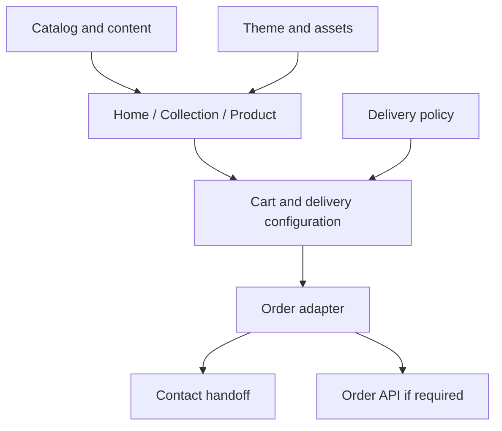

# Reconstruction Architecture

All choices in this document are **PROPOSED**. The available evidence does not identify the original framework, backend, or CMS.

## Implementation approach

Keep a suitable existing repository stack. For a new prototype, React and TypeScript with Vite and an appropriate router are an option. If the production storefront needs SEO, select SSR/SSG during the foundation phase or add verified prerendering. Pin versions through the lockfile for the deployment environment. Do not assume the original site uses React.

Use CSS variables with CSS modules or plain CSS. A UI library may provide behavior, but its appearance must be adapted to the reference. Default shadcn, Material, or Bootstrap styling is not a cloned theme.

## Module boundaries

| Module | Responsibility |
|---|---|
| Theme | Measured tokens, fonts, responsive overrides |
| CatalogRepository | Products, variants, collections, ordering |
| AssetResolver | Remote/local assets and responsive variants |
| CatalogQuery | Filtering, sorting, pagination |
| CartStore | Lines, persistence, migrations, merge rules |
| DeliveryPolicy | Eligibility, cutoffs, holiday rules |
| OrderAdapter | Mock, backend, or contact handoff |
| ContentRepository | Homepage blocks, policies, business settings |
| Routes | Canonical URLs, aliases, metadata, error boundaries |

Components must not invent pricing formulas that differ from the domain/service layer.

## Suggested repository structure

| Path | Contents |
|---|---|
| `src/theme/` | Theme JSON, tokens.css, fonts.css |
| `src/components/` | Header, card, price, input, dialog |
| `src/features/catalog/` | Queries and collection views |
| `src/features/product/` | Gallery, variants, product views |
| `src/features/cart/` | Store and cart surface |
| `src/features/order/` | Delivery, contact, order adapter |
| `src/pages/` | Home, collection, product, policy, not-found |
| `src/data/` | Typed fixtures and content |
| `src/lib/` | Money, date, and URL helpers |
| `public/assets/` | Imported logos, images, and font files |
| `tests/` | Meaningful price, scheduling, route, and flow tests |
| `docs/reference/` | This Markdown package and the evidence log |

## Initial interfaces

```typescript
interface CatalogRepository {
  getProduct(slug: string): Promise<Product | null>;
  getCollection(slug: string): Promise<Collection | null>;
  query(input: CatalogQuery): Promise<CatalogResult>;
}
interface OrderAdapter {
  prepare(draft: OrderDraft): Promise<OrderPreview>;
  submit(draft: OrderDraft, idempotencyKey: string): Promise<OrderResult>;
}
```

`Product`, `Collection`, and `OrderDraft` are domain types defined in the data specification. `OrderPreview/Result` must distinguish `handoff-ready`, `pending-confirmation`, and `failed`. A contact adapter must not invent a server order ID.

## Data flow



This is the reconstruction's architecture, not a diagram of the original source.

## Avoid premature scope expansion

Add admin dashboards, inventory management, payment gateways, promotion engines, or authentication only when confirmed by the reference or a new requirement. A complete storefront reconstruction does not require inventing unseen internal systems.

## Deployment

Support refreshes on `/collections/:slug/` and `/products/:slug/`. Static hosting needs appropriate fallback or prerendering. Production canonical metadata uses the reconstruction's deployment domain. Do not send test orders or analytics to the reference site's production services.
