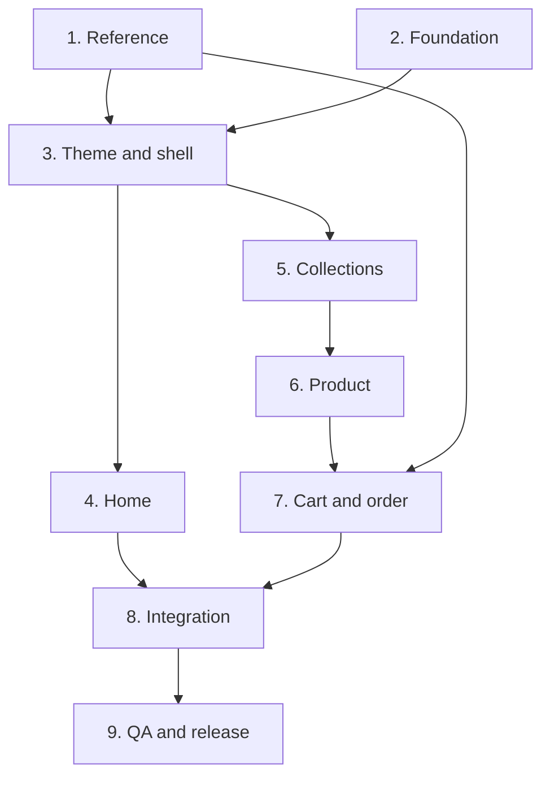

# Implementation Roadmap

These phases guide implementation after a coding agent receives the package. They do not report that the website has already been built.

| Phase | File | Primary outcome | Dependencies |
|---|---|---|---|
| 1 | [01-reference.md](01-reference.md) | Confirm routes, assets, and theme evidence | Existing partial audit |
| 2 | [02-foundation.md](02-foundation.md) | Repository, domain types, routing, fixtures | Can begin while phase 1 continues |
| 3 | [03-theme-and-shell.md](03-theme-and-shell.md) | Theme, fonts, primitives, header/footer | Phase 1 visual evidence + phase 2 |
| 4 | [04-home.md](04-home.md) | Homepage and campaign blocks | Phases 2 + 3 |
| 5 | [05-collections.md](05-collections.md) | Catalog, filters, sorting, load-more | Phases 2 + 3; interaction evidence from 1 |
| 6 | [06-product.md](06-product.md) | PDP, gallery, variants | Phases 2 + 3 + cards from 5 |
| 7 | [07-cart-and-order.md](07-cart-and-order.md) | Cart, scheduling, order handoff | Phase 6 + order evidence from 1 |
| 8 | [08-content-and-integration.md](08-content-and-integration.md) | Policies, redirects, SEO, adapters | Phases 4–7 |
| 9 | [09-qa-and-release.md](09-qa-and-release.md) | End-to-end QA, visual fidelity, deployment | Earlier phases |

## Dependency graph

## Progress tracking

| Phase | Documentation | Implementation |
|---|---|---|
| 1 | Text audit available; capture/runtime evidence missing | Complete reference collection remains unfinished |
| 2–9 | Instructions, acceptance criteria, and prompts available | Not started within this package |

Avoid fixed duration estimates until catalog/assets and checkout structure are understood. The largest tasks are obtaining correct references, importing accurate catalog data, and comparing rendered interfaces. Code-file counts do not measure completion.

## Working rules for each phase

1. Read the README, latest handoff, and relevant phase files.
2. Record missing inputs and continue independent work with sufficient evidence.
3. Implement against the phase's acceptance criteria without redesigning the reference.
4. Verify the risks introduced by the changes; avoid unnecessary repeated full-suite runs.
5. Update the handoff with completed work, evidence, changes, tests, gaps, and next tasks.
6. Distinguish **implemented**, **functionally verified**, and **visually verified**.

Missing theme values need not block pricing models or routing, but the theme remains incomplete. Missing checkout evidence can be handled with an explicitly labeled mock adapter for domain tests; it does not establish final flow fidelity.
